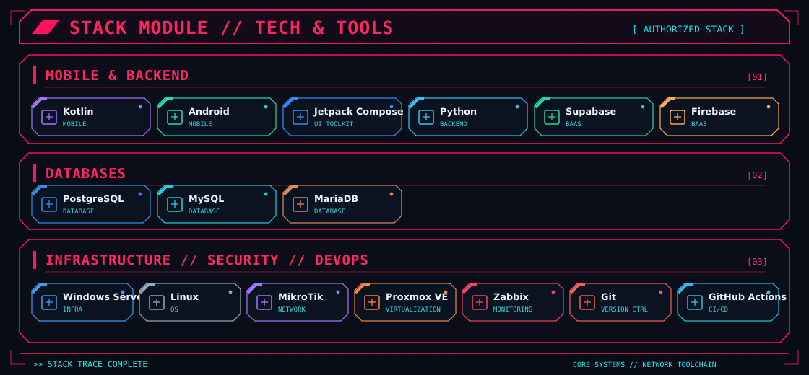

# Hi, I'm Melque Henrique 👋

**Software Developer · Infrastructure & Security Background · Android Enthusiast**

*Building useful products, exploring technology, and turning ideas into working software.*

---

### About me

I'm a **Computer Science graduate** with a professional background in **network infrastructure and information security**, currently focused on **software engineering and native Android development**.

I enjoy designing practical solutions, from backend services to mobile experiences, with an emphasis on clarity, maintainability, and thoughtful interfaces.

- 📱 Developing a social reading app for Android, focused on connecting readers and sharing reading experiences.
- 🛡️ Interested in **network security, infrastructure automation, and security policy verification**.
- 🧠 Working with **Kotlin, Jetpack Compose, Python, and Supabase**.
- 📚 A reader who enjoys fantasy and science fiction.
- 📍 Based in Brazil.

## Tech & tools

### GitHub activity

  
  Contribution counts: last 12 months · Language distribution: authorized, non-fork, non-archived owned repositories · Private repo names are never shown.

---

*Good software starts with curiosity and grows through consistency.*

